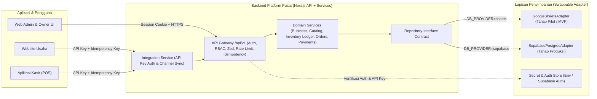

# DOKUMEN SPESIFIKASI PRODUK (PRD) & MASTER CONTEXT
**Projek:** Multi-Business Omnichannel Platform *(Nama Sementara)*
**Arsitek Sistem:** ZettBOT by Zettbos (Core v4.1)
**Tanggal Pembaruan:** 21 November 2026
**Status Dokumen:** TAHAP 2 (MVP) SELESAI — SIAP UJI COBA & LANJUT TAHAP 3 (INTEGRASI)

================================================================================
## ZONA ATAS: SPESIFIKASI KEBUTUHAN PRODUK (BLUEPRINT TAHAP 1)
================================================================================

### 1. Ringkasan Pemahaman & Ruang Lingkup Sistem
- **Visi Produk:** Membangun satu platform pusat (*Central Operations Hub*) untuk mengelola, menghubungkan, menyinkronkan, dan memantau operasional dari **banyak usaha berbeda** milik satu pemilik (contoh: usaha fashion dengan web store + toko fisik, usaha F&B dengan POS + marketplace, usaha jasa dengan web pemesanan) tanpa perlu membangun aplikasi omnichannel terpisah untuk tiap usaha baru.
- **Prinsip Pembangunan:** Bertahap (*incremental delivery*). Dimulai dari **MVP yang ramping, nyata, dan terhubung penuh ke backend** (bukan tampilan dummy), lalu berkembang ke integrasi eksternal, migrasi database ke PostgreSQL/Supabase, hingga otomatisasi dan analitik lanjutan.
- **Batasan Tegas (*Out of Scope*):**
  - **TIDAK ADA fitur komunikasi pelanggan** (tidak ada WhatsApp inbox, WhatsApp API, Instagram DM, live chat, atau ticketing customer service).
  - **TIDAK ADA payment gateway otomatis** di tahap awal (pembayaran menggunakan transfer bank / QRIS langsung ke rekening pemilik dengan verifikasi manual oleh admin).
  - **TIDAK ADA komunikasi langsung Frontend → Database / Google Sheets** (semua lalu lintas data wajib melewati Backend API).

---

### 2. Peran Pengguna & Isolasi Multi-Usaha (Multi-Tenant RBAC)
1. **Owner (Super Admin):**
   - Akses penuh ke seluruh usaha (*cross-business visibility*), laporan gabungan, pembuatan usaha baru, manajemen user & role, konfigurasi integrasi, serta pengaturan sistem.
2. **Business Manager / Admin Usaha:**
   - Hanya dapat mengakses usaha yang ditugaskan kepadanya (`business_users`). Mengelola produk, stok, pesanan, dan verifikasi pembayaran manual pada usaha tersebut.
3. **Staff Operasional / Gudang / Kasir:**
   - Akses terbatas sesuai role pada usaha & lokasi tertentu (misal: hanya pencatatan stok masuk/keluar atau melihat/memproses pesanan).
- **Aturan Isolasi Data:**
  - Setiap tabel operasional wajib memiliki `business_id`.
  - Backend wajib memvalidasi kepemilikan/hak akses `business_id` pada setiap request (bukan sekadar menyembunyikan menu di frontend).
  - Stok, pesanan, dan transaksi antarusaha tidak pernah digabungkan secara otomatis dalam operasi harian; agregasi lintas usaha hanya terjadi pada layer laporan Owner.

---

### 3. Rekomendasi Arsitektur Aplikasi (Layered & Adapter Pattern)
Sistem menggunakan **Modular Monolith Full-Stack** dengan pemisahan layer yang tegas agar mudah dirawat pada tahap MVP namun siap dipecah atau dimigrasi database-nya kapan saja:

1. **Presentation Layer (Frontend UI — Next.js App Router + TypeScript + Tailwind CSS):**
   - Hanya merender antarmuka, mengelola state UI, dan memanggil Backend API (`/api/v1/...`).
   - Tidak mengenal Google Sheets maupun PostgreSQL.
2. **API & Auth Layer (Next.js Route Handlers `/api/v1/...`):**
   - Menangani autentikasi sesi pengguna (JWT HTTP-only cookie) & autentikasi aplikasi eksternal (API Key), validasi skema input (Zod), otorisasi `business_id`, rate limiting, idempotency check, dan format respons standar.
3. **Domain / Service Layer (`src/services/`):**
   - Pusat seluruh logika bisnis: kalkulasi pesanan, aturan *inventory ledger*, pencegahan *overselling*, pemisahan status pesanan vs pembayaran, audit logging.
   - Hanya berkomunikasi dengan **Repository Interfaces** (tidak tahu database apa yang dipakai di belakangnya).
4. **Database Service Layer — Repository & Adapter Pattern (`src/db/`):**
   - Mendefinisikan kontrak interface standar (`IBusinessRepository`, `IProductRepository`, `IInventoryRepository`, `IOrderRepository`, dll.) dengan operasi: `create`, `findById`, `query`, `update`, `delete`, serta `withTransaction` (didukung penuh di Postgres, disimulasikan dengan mutex lock terbatas di Google Sheets).
   - **Adapter 1 (Pilot/MVP):** `GoogleSheetsAdapter` (menggunakan `googleapis` Service Account di server).
   - **Adapter 2 (Produksi):** `SupabasePostgresAdapter` (menggunakan `@supabase/supabase-js` atau Drizzle/Prisma ORM + PostgreSQL Transactions & RLS).
   - Perpindahan database cukup mengubah implementasi adapter melalui konfigurasi environment (`DB_PROVIDER=sheets | supabase`).
5. **Integration Service Layer (`src/integrations/`):**
   - Menerima webhook/request dari website usaha, aplikasi kasir (POS), dan marketplace melalui API terotentikasi.
   - Menyediakan kontrak `IChannelAdapter` (untuk tahap awal menggunakan Mock/Webhook Adapter yang ditandai eksplisit sebagai simulasi hingga aplikasi klien terhubung).

---

### 4. Diagram Alur Data (Data Flow)

---

### 5. Struktur Database Awal (14 Tabel Relasional — Siap Migrasi ke PostgreSQL)
**Standar Umum:**
- Seluruh ID menggunakan **UUID v4** atau **Prefixed ULID** (contoh: `biz_01J...`, `prd_01J...`, `ord_01J...`) yang dihasilkan di backend—**dilarang menggunakan nomor baris Google Sheets sebagai ID**.
- Format waktu standar: **ISO 8601 UTC** (`2026-11-21T08:15:30Z`), dikonversi ke `Asia/Jakarta` (WIB) hanya di layer tampilan UI.
- Mata uang: **IDR** disimpan sebagai bilangan bulat (`INTEGER / BIGINT`, tanpa desimal mengambang).
- Penamaan kolom & tabel: `snake_case` konsisten agar 1:1 dengan skema PostgreSQL. Pada Google Sheets API, setiap referensi tab sheet wajib dibungkus tanda petik tunggal (`'business_users'!A:Z`).
- **Aturan Nol Rahasia di Google Sheets:** Tidak ada password mentah, access token, API secret, atau data sensitif rekening yang disimpan di Google Sheets.

#### Daftar 14 Tabel & Kolom Utama:
1. **`businesses`** — Master unit usaha
   - `id` (PK), `code` (Unique), `name`, `category` (`fashion|fnb|service|retail|other`), `logo_url`, `contact_email`, `contact_phone`, `address`, `enabled_modules_json` (menu yang aktif per usaha), `is_active`, `created_at`, `updated_at`
2. **`users`** — Profil pengguna (NON-rahasia; kredensial autentikasi di Auth Provider / Secret Store)
   - `id` (PK), `auth_subject_id` (ref ke Auth Provider), `full_name`, `email` (Unique), `global_role` (`owner|member`), `is_active`, `created_at`, `updated_at`
3. **`business_users`** — Pemetaan hak akses user ke usaha (Multi-Tenant RBAC)
   - `id` (PK), `business_id` (FK → `businesses`), `user_id` (FK → `users`), `role` (`admin|manager|staff|viewer`), `location_scope_id` (nullable FK → `locations`), `is_active`, `created_at`
4. **`locations`** — Cabang, toko fisik, gudang, atau titik operasional per usaha
   - `id` (PK), `business_id` (FK → `businesses`), `code`, `name`, `type` (`store|warehouse|kitchen|office`), `address`, `is_primary_stock_source` (Boolean), `is_active`, `created_at`
5. **`products`** — Katalog produk & layanan per usaha
   - `id` (PK), `business_id` (FK → `businesses`), `sku` (Unique per business), `name`, `description`, `category`, `product_type` (`physical|service`), `image_url`, `base_price_idr`, `track_inventory` (Boolean), `is_active`, `created_at`, `updated_at`
6. **`product_variants`** — Variasi produk (ukuran, warna, porsi, paket layanan)
   - `id` (PK), `business_id` (FK → `businesses`), `product_id` (FK → `products`), `sku` (Unique per business), `variant_name`, `attributes_json`, `price_idr`, `is_active`, `created_at`
7. **`inventory`** — Saldo stok saat ini per varian & lokasi (Single Source of Truth)
   - `id` (PK), `business_id` (FK → `businesses`), `product_id` (FK → `products`), `variant_id` (nullable FK → `product_variants`), `location_id` (FK → `locations`), `qty_on_hand`, `qty_reserved`, `qty_available` (`on_hand - reserved`), `low_stock_threshold`, `updated_at`
8. **`inventory_movements`** — Buku besar pergerakan stok (*Immutable Inventory Ledger*)
   - `id` (PK), `business_id` (FK → `businesses`), `inventory_id` (FK → `inventory`), `product_id`, `variant_id`, `location_id`, `movement_type` (`stock_in|stock_out|sale|order_cancel|return|adjustment|transfer_in|transfer_out|opname`), `qty_delta` (+/-), `qty_before`, `qty_after`, `reference_type` (`order|manual|transfer|opname`), `reference_id`, `notes`, `created_by`, `created_at`
9. **`orders`** — Pesanan & transaksi penjualan lintas kanal
   - `id` (PK), `business_id` (FK → `businesses`), `order_number` (`ORD-YYYYMM-XXXX`), `idempotency_key` (Unique per business/integration), `channel` (`manual|website|pos|marketplace`), `integration_id` (nullable FK → `integrations`), `location_id` (nullable FK → `locations`), `customer_name`, `customer_contact`, `subtotal_idr`, `discount_idr`, `total_idr`, `order_status` (`pending|confirmed|processing|completed|cancelled|refunded`), `payment_status` (`pending|waiting_verification|paid|failed|refunded`), `notes`, `created_at`, `updated_at`
10. **`order_items`** — Rincian item pesanan
    - `id` (PK), `business_id` (FK → `businesses`), `order_id` (FK → `orders`), `product_id` (FK → `products`), `variant_id` (nullable FK → `product_variants`), `sku_snapshot`, `product_name_snapshot`, `qty`, `unit_price_idr`, `line_total_idr`
11. **`payments`** — Pencatatan & verifikasi pembayaran manual (Transfer Bank / QRIS)
    - `id` (PK), `business_id` (FK → `businesses`), `order_id` (FK → `orders`), `amount_idr`, `payment_method` (`bank_transfer|qris|cash`), `destination_account_label` (hanya nama bank & label rekening tujuan, TANPA PIN/login/data rahasia), `payment_status` (`pending|waiting_verification|paid|failed|refunded`), `proof_url` (nullable), `paid_at`, `verified_by` (nullable FK → `users`), `verified_at`, `verification_notes`, `created_at`
12. **`integrations`** — Konfigurasi kanal eksternal per usaha (TANPA secret mentah di sheet)
    - `id` (PK), `business_id` (FK → `businesses`), `name`, `channel_type` (`website|pos|marketplace`), `api_key_prefix` (contoh: `mbop_live_8a3f...` untuk identifikasi di UI; hash key disimpan di Secret Store/Env), `webhook_url`, `status` (`active|paused|revoked|simulated`), `last_synced_at`, `created_at`
13. **`sync_logs`** — Log sinkronisasi & error integrasi eksternal
    - `id` (PK), `business_id` (FK → `businesses`), `integration_id` (FK → `integrations`), `direction` (`inbound|outbound`), `entity_type` (`order|inventory|product`), `entity_id`, `idempotency_key`, `status` (`success|failed|retrying`), `http_status`, `error_message`, `created_at`
14. **`audit_logs`** — Jejak audit keamanan & aktivitas penting
    - `id` (PK), `business_id` (nullable FK → `businesses`), `actor_user_id`, `action` (contoh: `PAYMENT_VERIFIED`, `STOCK_ADJUSTED`, `API_KEY_REVOKED`), `entity_type`, `entity_id`, `payload_summary_json`, `ip_address`, `created_at`

---

### 6. Rancangan Backend API (`/api/v1`)
**Kontrak Standar:**
- **Format Sukses:** `{ "success": true, "data": ..., "meta": { "page": 1, "limit": 20, "total": 100 } }`
- **Format Error:** `{ "success": false, "error": { "code": "INSUFFICIENT_STOCK", "message": "...", "details": [...] } }`
- **Autentikasi:**
  - Dashboard Web: `HTTP-only Session Cookie` (JWT bertanda tangan + CSRF protection).
  - Aplikasi Eksternal (Website / POS): Header `X-API-Key: <key>` + `X-Idempotency-Key: <uuid>` (wajib pada POST order/transaksi).
- **Endpoint Utama:**
  - `POST /api/v1/auth/login`, `POST /api/v1/auth/logout`, `GET /api/v1/auth/me`
  - `GET/POST /api/v1/businesses`, `GET/PATCH /api/v1/businesses/:id`, `GET/POST /api/v1/businesses/:id/locations`
  - `GET/POST /api/v1/products`, `GET/PATCH/DELETE /api/v1/products/:id`, `POST /api/v1/products/:id/variants`
  - `GET /api/v1/inventory`, `POST /api/v1/inventory/movements` (stock_in, stock_out, adjustment, transfer, opname), `GET /api/v1/inventory/movements`
  - `GET/POST /api/v1/orders`, `GET/PATCH /api/v1/orders/:id`, `POST /api/v1/orders/:id/cancel`
  - `GET/POST /api/v1/payments`, `POST /api/v1/payments/:id/verify` (verifikasi manual admin: Paid / Failed / Refunded)
  - `GET/POST /api/v1/integrations`, `POST /api/v1/integrations/:id/rotate-key`, `POST /api/v1/integrations/inbound/orders`, `GET /api/v1/integrations/sync-logs`
  - `GET /api/v1/dashboard/summary` (filter `business_id`, `from`, `to`)

---

### 7. Rancangan Menu & Halaman (Sidebar Navigation Fleksibel)
Struktur 9 menu sidebar dengan kontrol visibilitas dinamis (`enabled_modules_json` per usaha, misal usaha jasa dapat menyembunyikan modul Inventory):

| No | Menu Sidebar | Cakupan Utama | Tahap Implementasi |
| :-: | :--- | :--- | :--- |
| 1 | **Dashboard** | KPI gabungan/per usaha, status bayar, stok menipis, grafik penjualan, filter usaha & periode | **Tahap 2 (MVP Dasar)** → Tahap 5 (Perbandingan Lanjutan) |
| 2 | **Business Management** | Daftar usaha, tambah/edit profil usaha, kategori, lokasi/cabang, status aktif | **Tahap 2 (MVP)** |
| 3 | **Product & Catalog** | Daftar produk/jasa per usaha, SKU, variasi, harga IDR, status aktif | **Tahap 2 (MVP)** |
| 4 | **Inventory Management** | Saldo stok per lokasi, stok masuk/keluar/penyesuaian, buku besar pergerakan stok, alert stok menipis | **Tahap 2 (MVP Sederhana)** → Tahap 5 (Transfer & Opname Multi-Lokasi) |
| 5 | **Orders & Sales** | Daftar pesanan, detail drawer, buat pesanan manual, status pesanan vs status bayar, pembatalan | **Tahap 2 (MVP Sederhana)** → Tahap 3 (Verifikasi Bayar Manual & Inbound Sync) |
| 6 | **Integrations** | Kelola koneksi Website/POS/Marketplace, generate/revoke API key, status koneksi, sync logs & error | **Tahap 3 (Integrasi)** |
| 7 | **Automation** | Aturan sinkronisasi stok, trigger status pesanan, notifikasi internal stok/pesanan, log eksekusi | **Tahap 5 (Pengembangan Lanjutan)** |
| 8 | **Reports & Analytics** | Laporan penjualan, stok, terlaris, performa tiap & gabungan usaha, ekspor CSV/Excel | **Tahap 5 (Pengembangan Lanjutan)** |
| 9 | **Settings** | Profil user, manajemen user & RBAC per usaha, status database adapter, keamanan, audit log | **Tahap 2 (Profil & Status DB)** → Tahap 3–5 (RBAC Lengkap & Audit Log) |

---

### 8. Peta Jalan Bertahap & Rencana MVP (Tahap 2)
- **Tahap 1 — Perencanaan (SEKARANG):** Finalisasi arsitektur, 14 skema tabel, kontrak API, UI/UX, risiko, dan rencana migrasi.
- **Tahap 2 — MVP (Fondasi Berfungsi Penuh):**
  1. Autentikasi Login/Logout + Proteksi Route & API (`Owner` & RBAC dasar per `business_id`).
  2. Repository Interface + `GoogleSheetsAdapter` (lengkap dengan in-memory mutex lock & script inisialisasi 14 sheet).
  3. **Business Management:** CRUD Usaha + Lokasi utama.
  4. **Product & Catalog:** CRUD Produk + Variasi sederhana per usaha.
  5. **Inventory Management (Ledger):** Lihat stok, Stok Masuk, Stok Keluar, Penyesuaian, Riwayat Pergerakan, Alert Stok Menipis.
  6. **Orders & Sales (Dasar):** Daftar pesanan, Detail pesanan, Buat pesanan (memotong stok via ledger & mencegah overselling), Ubah status pesanan, Catat status pembayaran dasar.
  7. **Dashboard Dasar:** Metrik total penjualan, total pesanan, ringkasan stok menipis, filter per usaha/semua usaha.
  8. **API v1 Dasar** terdokumentasi + tervalidasi Zod.
  *(Catatan: Menu Tahap 3–5 tidak dipenuhi tombol palsu/dummy di MVP—disembunyikan atau ditandai jelas sebagai modul tahap berikutnya sesuai prinsip anti-fake UI).*
- **Tahap 3 — Integrasi & Pembayaran Manual:** API Key Management, Inbound Order API (`X-Idempotency-Key`) untuk Website & POS, Outbound Stock Sync Webhook + Mock Simulator berlabel jelas, Alur Verifikasi Pembayaran Manual (Transfer/QRIS), `sync_logs`.
- **Tahap 4 — Migrasi Database ke Supabase (PostgreSQL):** Implementasi `SupabasePostgresAdapter`, PostgreSQL ACID Transactions (`SELECT ... FOR UPDATE`), Row Level Security (RLS), CLI Migration & Verification Script dari Google Sheets → Supabase.
- **Tahap 5 — Pengembangan Lanjutan:** Automation Engine, Reports & Analytics + Ekspor CSV/Excel, Multi-Location Stock Transfer & Opname, Konektor Marketplace nyata.

---

### 9. Analisis Risiko Teknis & Keamanan
1. **Race Condition & Overselling di Google Sheets:** Google Sheets tidak memiliki ACID transaction atau row locking. *Mitigasi:* Batasi tahap pilot ke single-instance backend + in-process mutex queue per `(business_id, product_id, location_id)` + batasi jumlah user operasional (maks 3–5 staf). Wajib migrasi ke PostgreSQL (`FOR UPDATE`) sebelum trafik tinggi.
2. **Rate Limit Google Sheets API (60 req/menit/user):** Pembacaan berulang bisa terkena HTTP 429. *Mitigasi:* Server-side short-TTL caching untuk data master (businesses/products) dengan invalidasi otomatis saat mutasi + batch read/write.
3. **Penyimpanan Kredensial & API Key Tanpa Menyentuh Google Sheets:** *Mitigasi:* Password hash, session secret, dan hash API Key TIDAK disimpan di Google Sheets. Disimpan di Environment Variables / Auth Store terpisah (atau langsung menggunakan Supabase Auth khusus untuk autentikasi sejak MVP sambil tabel bisnis tetap di Google Sheets).
4. **Kebocoran Data Antar-Usaha (IDOR / Cross-Tenant Leak):** *Mitigasi:* Setiap query repository mewajibkan parameter `business_id` yang diekstrak/diverifikasi dari sesi user atau pemilik API key di backend.
5. **Duplikasi Pesanan dari Website/POS (Network Retry):** *Mitigasi:* Wajib header `X-Idempotency-Key` pada endpoint pembuatan pesanan; request ulang dengan key sama mengembalikan pesanan awal tanpa memotong stok dua kali.
6. **Pembayaran Palsu pada Verifikasi Manual:** *Mitigasi:* Unggah bukti transfer hanya mengubah status ke `waiting_verification`, TIDAK PERNAH otomatis menjadi `paid`. Perubahan ke `paid` hanya bisa dilakukan user berwenang dan tercatat di `audit_logs`.

---

### 10. Rencana Migrasi Google Sheets → Supabase (PostgreSQL)
1. **Persiapan Skema:** Menjalankan SQL migration di Supabase untuk 14 tabel dengan Primary Key UUID/ULID, Foreign Key constraints, indeks `(business_id, created_at)`, dan Row Level Security (RLS).
2. **ETL Migration Tool (`scripts/migrate-sheets-to-supabase.ts`):**
   - Membaca 14 sheet secara berurutan sesuai hierarki dependensi Foreign Key (`businesses` → `users` → `locations` → `products` → `inventory` → `orders` → `order_items` → `payments` → logs).
   - Validasi tipe data (tanggal ISO, integer IDR, JSON valid) dan relasi FK sebelum insert.
   - Mempertahankan 100% ID asli agar referensi historis dan integrasi tidak putus.
   - Menghasilkan laporan migrasi JSON/Markdown (jumlah baris sumber vs tujuan, daftar baris gagal & alasannya, checksum total omzet dan total saldo stok).
3. **Cutover & Rollback:** Aktifkan *read-only maintenance window* singkat (5–15 menit) → jalankan migrasi → verifikasi checksum 100% cocok → ubah environment `DB_PROVIDER=supabase` → restart server. Jika ada anomali, rollback instan cukup kembalikan `DB_PROVIDER=sheets`.

---

### 11. Rekomendasi Teknologi Final
- **Framework Full-Stack:** **Next.js (App Router) + TypeScript** — Satu codebase terpadu untuk UI modern dan Backend API Routes (`/api/v1/...`), type-safety penuh antar Frontend, Service, dan Repository Interface.
- **Styling & Komponen UI:** **Tailwind CSS + Lucide Icons + Recharts** (untuk grafik di Dashboard) — Bersih, konsisten, responsif desktop & tablet, tanpa beban library berat.
- **Validasi Input & Kontrak API:** **Zod** — Validasi skema ketat di backend dan berbagi tipe otomatis ke TypeScript.
- **Database Tahap Awal:** **Google Sheets API (`googleapis`)** di balik `GoogleSheetsAdapter`.
- **Database Tahap Produksi:** **Supabase (PostgreSQL)** di balik `SupabasePostgresAdapter` (mendukung transaksi ACID untuk stok & RLS untuk isolasi multi-usaha).
- **Autentikasi:** **JWT Session (HTTP-only Cookie via `jose` + `bcryptjs`)** dengan penyimpanan kredensial terpisah dari Google Sheets (Env/Encrypted Auth Store pada pilot lokal, atau langsung **Supabase Auth**).
- **Deployment:** **Vercel** (paling mulus untuk Next.js) atau **VPS / Docker** (lebih direkomendasikan bila fase Google Sheets membutuhkan single-instance mutex lock in-memory yang persisten!).

================================================================================
## ZONA BAWAH: MASTER CONTEXT & LOGIKA SISTEM TERKINI (LIVING CONTEXT)
================================================================================

### 1. Status Arsitektur & Lingkungan Aktif
- **Nama Projek:** Multi-Business Omnichannel Platform *(Nama Sementara)*
- **Fase Aktif:** Tahap 2 (MVP) Selesai & Dimigrasi ke **Neon PostgreSQL + Vercel Serverless** — Siap Deploy & Persiapan Tahap 3 (Integrasi Website/POS & API Keys).
- **Arsitektur:** Modular Monolith (Next.js 14 App Router + TypeScript + Tailwind CSS + Recharts + Zod) dengan Repository/Adapter Pattern (`src/db/interfaces/repository.ts` → **`NeonPostgresAdapter`** sebagai adapter utama via `@neondatabase/serverless`, auto-detect dari `DATABASE_URL` / `POSTGRES_URL` Vercel; tetap kompatibel dengan `LocalJsonAdapter` untuk uji offline).
- **Keamanan & Autentikasi (Vercel Serverless-Safe):** JWT HTTP-Only Cookie (`jose`) + Bcrypt (`bcryptjs`). Hash password disimpan pada tabel terisolasi **`auth_credentials`** di Neon PostgreSQL (0 penulisan filesystem di Vercel, auto-bootstrap Owner dari `OWNER_EMAIL` & `OWNER_PASSWORD` Vercel Env Vars). Multi-tenant RBAC ditegakkan di backend via `requireBusinessAccess`.
- **Inisialisasi Skema Otomatis:** `NeonPostgresAdapter` menjalankan DDL idempoten (`CREATE TABLE IF NOT EXISTS`) untuk 14 tabel operasional + `auth_credentials` secara otomatis saat koneksi pertama / login pertama, juga tersedia di `sql/001_initial_schema.sql`, `npm run db:init`, dan tombol 1-klik di menu **Settings**.
- **Kebijakan Ketat:** Tanpa fitur chat/komunikasi pelanggan (no WA/IG/Live Chat), tanpa payment gateway di MVP, tanpa akses langsung Frontend ke Database.

### 2. Skema Database Aktif (14 Tabel Operasional + 1 Tabel Auth Terisolasi — PostgreSQL)
- **Operasional:** `businesses`, `users`, `business_users`, `locations`, `products`, `product_variants`, `inventory`, `inventory_movements`, `orders`, `order_items`, `payments`, `integrations`, `sync_logs`, `audit_logs`.
- **Auth Terisolasi:** `auth_credentials` (`user_id`, `email`, `password_hash`, `updated_at`) — tidak pernah terekspos ke API publik.

### 3. Logika Bisnis & Aturan Integritas Berlaku
- **Inventory Ledger Wajib:** Setiap perubahan `inventory.qty_on_hand` wajib melalui `recordStockMovement()` (`src/services/inventory.service.ts`) di dalam `db.withLock()`, menciptakan baris baru di `inventory_movements`, dan memvalidasi `qty_available >= qty_keluar` (anti-overselling).
- **Pemisahan Status:** `order_status` terpisah secara independen dari `payment_status`.
- **Pembatalan Pesanan:** `POST /api/v1/orders/:id/cancel` otomatis mengembalikan stok produk terlacak melalui mutasi ledger `order_cancel`.
- **Verifikasi Pembayaran Manual:** `POST /api/v1/orders/:id/payment` mencatat status pembayaran (`pending`, `waiting_verification`, `paid`, `failed`, `refunded`), bukti transfer, admin verifikator, dan audit log.
- **Idempotency:** `POST /api/v1/orders` mendukung `X-Idempotency-Key` untuk mencegah duplikasi pesanan dan pemotongan stok ganda.

### 4. Log Pembaruan Resmi
- `21/11/2026`: Penyusunan Blueprint resmi **Multi-Business Omnichannel Platform** & implementasi **Tahap 2 (MVP)**.
- `22/11/2026`: Revisi Database & Vercel Readiness — Menambahkan **`NeonPostgresAdapter`** (`@neondatabase/serverless`, lazy init build-safe, auto-detect `DATABASE_URL` Vercel, DDL otomatis 14 tabel + `auth_credentials` di `sql/001_initial_schema.sql` & `scripts/init-neon.ts`) serta memperbaiki `src/lib/auth.ts` agar 100% bebas penulisan filesystem di Vercel Serverless.
